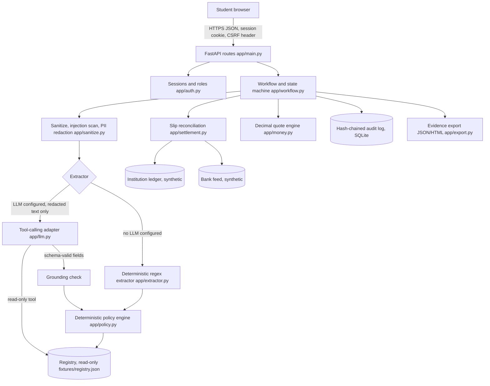
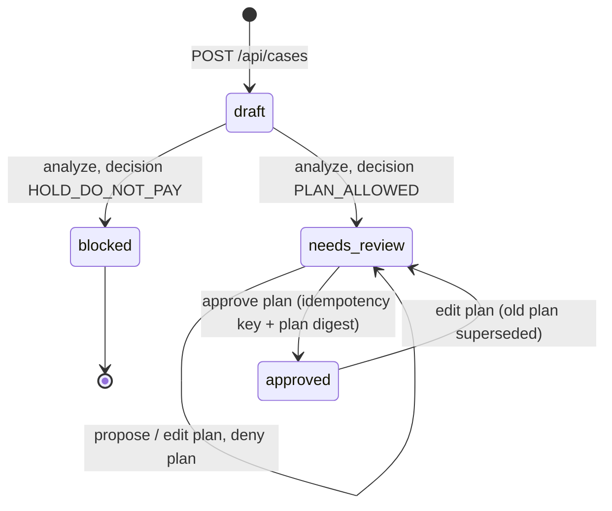

# CEKBAO technical documentation

Version 0.1.0, 20 October 2026. Team HMIF. FinTechathon 2026 International Track, Topic C.

Status labels in this document: **IMPLEMENTED** (code and automated tests exist), **MOCK-TESTED** (tested with a simulated dependency), **NOT VERIFIED** (no evidence yet).

## 1. Purpose and scope

CEKBAO checks a tuition or deposit payment request before the student pays. It does five things:

1. It reads a pasted request and extracts the payment fields.
2. It compares each field with a curated record of the university's official payment procedure.
3. It holds the payment when a field conflicts or cannot be checked.
4. It reconciles payment slips with a bank feed and the institution ledger.
5. It lets the student compare provider quotes and approve a sandbox payment plan. The plan is never executed.

Out of scope: real payments, bank or payment-provider APIs, KYC, visa or legal advice, and payee authentication against a bank registry.

## 2. Architecture

CEKBAO uses two layers. Layer 1 reads text. Layer 2 decides. Layer 2 never takes a status, a role or an approval from Layer 1 or from the client.



Stack: Python 3.11, FastAPI 0.150, Pydantic 2.14, SQLite (standard library), Jinja2 with autoescape, vanilla JavaScript. No framework on the client. No external scripts, fonts or images.

| Component | File | Responsibility |
|---|---|---|
| Routes and headers | `app/main.py` | HTTP routes, CSP and other security headers, body-size limit, error shaping |
| Sessions and roles | `app/auth.py` | Demo sign-in, PBKDF2 code hashes, random session tokens, CSRF, lockout |
| Workflow | `app/workflow.py` | State machine, owner scoping, plans, idempotency, uploads, case views |
| Sanitize | `app/sanitize.py` | Unicode NFKC, hidden and control characters, length limit, injection scan, redaction, masking |
| Extractor | `app/extractor.py` | Regex extraction for English and Indonesian messages, negation-aware |
| LLM adapter | `app/llm.py` | OpenAI-compatible tool loop, allowlisted tools, strict schema, grounding |
| Policy | `app/policy.py` | Field comparisons, risk signals, decision rule |
| Registry | `app/registry.py` | Read-only institution records with provenance checks |
| Settlement | `app/settlement.py` | Slip vs bank feed vs ledger timeline and status |
| Money | `app/money.py` | Quote validation and all-in cost |
| Escalation | `app/escalation.py` | Checklist and draft e-mail to the registry contact |
| Audit | `app/audit.py` | Append-only hash chain per case, access log |
| Export | `app/export.py` | Reproducible JSON and HTML bundle |
| URL guard | `app/urlguard.py` | Link assessment and allowlist-only fetch for registry maintenance |

## 3. Core algorithm

### 3.1 Request check (Scenarios A, C, D)

1. **Sanitize.** Normalize to NFKC. Remove zero-width and bidirectional control characters and flag them. Reject empty text and text over 20,000 characters.
2. **Scan for injection.** Match phrases such as "ignore previous instructions", "set the status to", "approve the payment", "SYSTEM:". A hit becomes a high-severity risk signal. The text stays data.
3. **Redact.** Replace e-mail addresses, IBANs, phone numbers, long digit runs and labelled ID numbers with placeholders (`[EMAIL_1]`, `[ACCOUNT_1]`). Only the redacted text can leave the process.
4. **Extract.** Without an LLM, the regex extractor reads `From:`, payee, account, SWIFT, bank, amount, methods, deadlines, links and phone numbers. Negated phrases ("we never ask for gift cards") do not count. With an LLM, see section 6.
5. **Resolve the institution.** Exact match on normalized name or alias. No fuzzy matching. An unknown name gives `NOT_VERIFIABLE`.
6. **Compare** each field with the registry entry:

| Check | MATCHED_SOURCE when | CONFLICT when | NOT_VERIFIABLE when |
|---|---|---|---|
| INSTITUTION | Name is in the registry | (never) | Name is not in the registry |
| SENDER_DOMAIN | `From:` domain equals an official domain or a real subdomain | Any other domain, look-alikes flagged | No sender address, or no registry entry |
| LINK_DOMAIN (each link) | Host is official, HTTPS, port 443 | User-info `@`, raw IP, punycode or non-ASCII host, look-alike, other host, HTTP | No registry entry |
| BENEFICIARY_NAME | Normalized name equals an approved channel payee | Different name | Missing payee or no registry entry |
| BENEFICIARY_ACCOUNT | Account equals an approved account or VA pattern | Other account | Transfer requested but no account given |
| SWIFT_BIC | Equals the approved SWIFT | Other SWIFT (country code compared) | No registry entry |
| PAYMENT_METHOD | Every method is approved | Any unapproved method (crypto, gift card, agent, personal account) | No method found |
| AMOUNT (information only) | (never) | (never) | Always. CEKBAO cannot see the invoice |
| POLICY_* | (never) | A risk signal contradicts a documented rule (no discounts via third parties, no agents, no threats) | (never) |

7. **Decide.**

```
overall = CONFLICT        if any finding is CONFLICT
        = NOT_VERIFIABLE  else if any required finding is NOT_VERIFIABLE
        = MATCHED_SOURCE  otherwise
decision = PLAN_ALLOWED_AFTER_STUDENT_CONFIRMATION
             only if overall == MATCHED_SOURCE and no high-severity risk signal
         = HOLD_DO_NOT_PAY otherwise
```

8. **Escalate.** Build a checklist and a draft e-mail. The recipient comes only from the registry. Attacker instructions are not copied into the e-mail. `auto_send` is always `false`.

### 3.2 Slip reconciliation (Scenario B)

For each slip the engine builds a timeline from four sources: the slip (student-provided, unauthenticated), the upload metadata, the sandbox bank feed and the institution ledger. Lookups use the payer reference of the **signed-in user**, never a client field.

| Issue code | Rule |
|---|---|
| PAYER_REFERENCE_MISMATCH | Slip payer reference differs from the signed-in student. No lookup runs |
| DUPLICATE_SLIP_ID | Same slip ID twice in one submission or in an earlier case |
| FUTURE_DATE | Slip date is after today |
| WRONG_DESTINATION | Destination is not an approved account or VA pattern |
| AMOUNT_MISMATCH | Bank record amount differs from the slip |
| DESTINATION_MISMATCH | Bank record destination differs from the slip |
| DATE_MISMATCH | Bank booking date differs by more than 2 days |
| LEDGER_AMOUNT_MISMATCH | Ledger has the same reference with another amount |

Status: any issue gives `CONFLICT` (next action `CONTACT_BANK_AND_INSTITUTION`). Otherwise a ledger record with the same reference, amount, currency and a credit date within 5 days gives `CONFIRMED_BY_INSTITUTION_LEDGER`. Otherwise the status is `PAYMENT_UNCONFIRMED` with next action `REQUIRES_INSTITUTION_CHECK`. Upload content never changes the status.

### 3.3 Case state machine



A blocked case cannot reach `approved`. Analysis runs once per case. Denial keeps the case, analysis and quotes unchanged.

## 4. Financial calculation definitions

All money values are `Decimal`. Inputs must be strings that match `^\d{1,13}(\.\d{1,8})?$`. Floats, signs and exponents fail.

For one quote, source currency S and target currency T:

| Term | Definition |
|---|---|
| fx_rate | Units of S charged per 1 unit of T |
| principal_source | expected_recipient_amount × fx_rate |
| percent_fee_source | principal_source × percent_fee / 100 |
| total_source_cost | principal_source + flat_fee + percent_fee_source |
| all_in_rate | total_source_cost / expected_recipient_amount |
| invoice_shortfall_target | max(0, invoice_amount − expected_recipient_amount − known intermediary fee) |
| markup_vs_reference_pct | (all_in_rate / reference_rate − 1) × 100 |

Rounding: intermediate values keep full precision. Outputs round once with ROUND_HALF_UP to 2 decimals (money) or 6 decimals (rates).

Rejections (HTTP 422, logged as `QUOTES_REJECTED`): rate 0, negative or malformed values, percent fee 100 or more, future quote date, same source and target currency, target currency different from the invoice, labels not unique, fewer than 2 or more than 3 quotes, and a rate more than 25% away from a student-provided reference rate.

Warnings (shown, not blocking): quote older than 7 days, percent fee above 10%, unknown intermediary fees, no quote that covers the invoice.

Worked example (Scenario C, illustrative numbers): Provider A, 500.00 USD at 16,450 IDR/USD, flat 50,000, 0.5% gives 8,225,000 + 41,125 + 50,000 = **8,316,125.00 IDR**. Provider B, 500.00 USD at 16,210, flat 150,000, 0% gives **8,255,000.00 IDR**. B is lower by 61,125.00 IDR. Unit test `test_all_in_cost_exact_decimal` asserts these values.

## 5. Data flow and retention

| Data | Stored | Form |
|---|---|---|
| Raw pasted message | Until analysis only | Sanitized text in `cases.input_json`. Replaced by the redacted text after analysis |
| Extracted fields | Yes | Account masked (`******9938`), phones masked, sender local part removed |
| Slip accounts | Yes | Masked after reconciliation |
| Receipt files | No | Name, media type, size and SHA-256 only |
| Intermediary phone | No | SHA-256 of institution + last 10 digits, for repeat detection |
| Session token | No | SHA-256 of the token |
| Demo access code | No | PBKDF2-SHA256 hash with a random salt |
| Idempotency key | Yes, in its own table | In the audit log only as SHA-256 |
| LLM API key | No | Environment only, `repr=False`, never logged or exported |

There is no automatic retention purge yet. See the security self-assessment.

## 6. LLM adapter (MOCK-TESTED, live provider NOT VERIFIED)

- Endpoint: `POST {LLM_BASE_URL}/chat/completions`, OpenAI-compatible, `temperature` 0, `tool_choice` auto, at most 4 steps.
- Input: system rules plus the **redacted** message inside `<untrusted_message>` tags.
- Tools: `lookup_institution(name)` is read-only and returns only `found`, ID, display name and the synthetic flag. `submit_extraction(...)` ends the loop. Any other tool name stops the loop and triggers the fallback.
- Validation: arguments must be valid JSON, then pass a Pydantic model with `extra="forbid"`, `strict=True`, length limits, regex patterns and enums. The same schema is sent to the model as the tool's JSON Schema.
- Grounding: each returned value is mapped back through the placeholder table. It must appear in the original text. Ungrounded values are dropped and raise an `UNGROUNDED_MODEL_OUTPUT` warning.
- Fallback: transport errors, non-200 responses, malformed output, schema failures and disallowed tools all switch to the deterministic extractor. The case shows `DETERMINISTIC_FALLBACK_AFTER_LLM_ERROR`.
- Authority: the model output only fills extraction fields. It cannot set statuses, roles, approvals or registry records.

## 7. Permissions

| Action | Anonymous | student (owner) | student (other) | office_reviewer |
|---|---|---|---|---|
| Read registry, samples, health | yes | yes | yes | yes |
| Create a case | no (401) | yes | n/a | no (403) |
| Analyze, quote, propose, approve, deny, upload | no (401) | yes | no (404) | no (403) |
| Read a case and its evidence export | no (401) | yes | no (404) | only escalated cases of own institution |
| Office escalation list | no (401) | no (403) | no (403) | own institution, no identities |
| Write the registry | no route exists | no route exists | no route exists | no route exists |

All mutating routes need the session cookie **and** the `X-CSRF-Token` header. Approval also needs an `Idempotency-Key` header and the plan revision and digest the student reviewed.

## 8. API summary

| Method and path | Purpose |
|---|---|
| `GET /api/health`, `GET /api/registry`, `GET /api/samples` | Public status, registry list, synthetic samples |
| `POST /api/session/login`, `POST /api/session/logout`, `GET /api/session/me` | Session |
| `GET /api/cases`, `POST /api/cases`, `GET /api/cases/{id}` | Cases |
| `POST /api/cases/{id}/analyze` | Run extraction, policy or reconciliation |
| `POST /api/cases/{id}/quotes` | Compare quotes |
| `POST /api/cases/{id}/plan/propose`, `/approve`, `/deny` | Plan workflow |
| `POST /api/cases/{id}/uploads` | Receipt metadata |
| `GET /api/cases/{id}/evidence.json`, `/evidence.html` | Evidence bundle |
| `GET /api/office/escalations` | Office inbox |

## 9. Registry format and real institutions

Each entry has: ID, display name, aliases, `synthetic` flag, country, official domains, official contact (office, e-mail, phone, contact page URL), approved channels (method, payee, account or VA pattern, SWIFT, bank, payment host), policy statements, and a source block (URL, retrieval date, reviewer, permitted-channel note). The loader rejects a non-synthetic entry without an `https` source URL and a named reviewer. The file's SHA-256 goes into every analysis and evidence bundle.

To add a real institution, a human must verify the official domain and payment page, record the exact URL and retrieval date, and describe the permitted channel. The current file contains no real institution.

## 10. Known technical limitations

- The regex extractor covers the sample formats. Unusual layouts can lead to `NOT_VERIFIABLE` (fail closed).
- Negation handling uses a 45-character window. Complex sentences can still trigger a false signal.
- Sender-domain matching does not check SPF, DKIM or DMARC.
- `safe_fetch` resolves DNS before connecting. A DNS rebinding race is still possible. The analysis flow does not use `safe_fetch`.
- Login lockout and the request-size limit are per process. There is no distributed rate limit.
- SQLite runs as one local file without encryption at rest.
